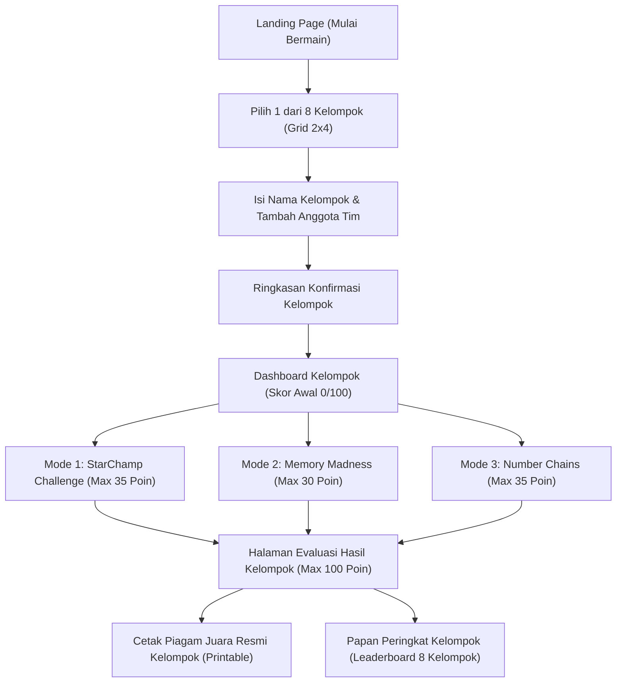

# THERMO CHAMPIONS 🏆
### Game Edukasi Berbasis Web — Clash of Champions Suhu 1 (IPA Kelas VII SMP)
> **Tagline:** *"Master the Temperature. Become the Champion."*

---

## 📌 Deskripsi Game
**THERMO CHAMPIONS** adalah media pembelajaran interaktif berbasis web untuk mata pelajaran Ilmu Pengetahuan Alam (IPA) Kelas VII SMP pada materi pokok **SUHU** (tidak mencakup kalor atau pemuaian).

Game dirancang sebagai media kompetisi akademik berbasis kelompok kooperatif di kelas:
- **Teknologi:** Murni **HTML5, CSS3, dan Vanilla JavaScript** (Zero dependency, tanpa framework React/Vue/Laravel).
- **Mekanisme Bermain:** **Dimainkan secara berkelompok (1 kelompok = 1 perangkat = 1 nilai kumulatif)**, BUKAN secara individu.
- **Tiga Konsep Arena:**
  1. **StarChamp Challenge** (*THERMO QUIZ*) — Bobot: **35 Poin** (10 Soal Pilihan Ganda konsep & jenis termometer, timer 30 detik/soal).
  2. **Memory Madness** (*THERMO MEMORY*) — Bobot: **30 Poin** (Fase 1: 30 detik memorisasi 10 kartu titik tetap; Fase 2: 10 soal recall 25 detik/soal).
  3. **Number Chains** (*THERMO CALCULATION*) — Bobot: **35 Poin** (5 tahapan rantai hitungan bertingkat dari mudah ke master, dilengkapi tombol petunjuk rumus).

**Total Nilai Maksimal:** **100 Poin** ($35 + 30 + 35$).

---

## 👥 Sistem Permainan Kelompok (8 Kelompok)

### 1. Pembagian 8 Kelompok Resmi
Game menyediakan tepat **8 Kelompok** dalam kartu pilihan berukuran besar dengan grid **2 Kolom × 4 Baris** pada desktop dan responsif di smartphone:
- **Kelompok 1** (*Tim Celsius* 🌡️) — Skala 0°C – 100°C
- **Kelompok 2** (*Tim Fahrenheit* 🔥) — Skala 32°F – 212°F
- **Kelompok 3** (*Tim Reamur* ⚗️) — Rasio skala 4 dan batas 80°R
- **Kelompok 4** (*Tim Kelvin* ❄️) — Satuan Internasional (SI) titik 273 – 373
- **Kelompok 5** (*Tim Bimetal* ⚙️) — Termometer dua keping logam muai
- **Kelompok 6** (*Tim Pirometer* 🎯) — Pengukuran radiasi termal optik jarak jauh
- **Kelompok 7** (*Tim Termokopel* ⚡) — Deteksi sinyal potensial termal rentang luas
- **Kelompok 8** (*Tim Kesetimbangan Termal* ⚖️) — Prinsip kesetimbangan suhu instrumen & benda

Dilengkapi:
- Judul: *"PILIH KELOMPOK KALIAN"*
- Petunjuk: *"Pilih satu kelompok untuk memulai tantangan. Seluruh anggota kelompok akan bermain bersama."*
- Informasi kelompok aktif: *"Kelompok yang dipilih: Kelompok X"*
- Tombol *"Ganti Kelompok"* untuk berpindah pilihan secara leluasa.

### 2. Pengisian Identitas Kelompok Mandiri
Setelah memilih kelompok, tim mengisi identitas secara mandiri:
1. **Nama Kelompok:** Diketik sendiri (misal: *The Thermo Squad*, *Celsius Warriors*, dll.).
2. **Daftar Anggota Tim:**
   - Fitur **"+ Tambah Anggota"** untuk menambahkan seluruh anggota kelompok.
   - Kolom **Nama Lengkap** anggota (diketik sendiri).
   - Kolom **Nomor Absen** (diketik sendiri, validasi wajib angka positif).
   - Tombol **Hapus Anggota (✕)** jika terjadi kesalahan ketik.
3. **Ringkasan Konfirmasi:** Menampilkan nomor kelompok, nama kelompok, dan rincian seluruh anggota tim sebelum menekan **"KONFIRMASI DAN MULAI"**.

---

## 🎮 Alur Permainan Kelompok


---

## 📊 Sistem Penilaian & Peringkat Kelompok

### A. Perhitungan Nilai Akhir
$$\text{Nilai Akhir Kelompok} = \text{Skor StarChamp (max 35)} + \text{Skor Memory (max 30)} + \text{Skor Number Chains (max 35)}$$

Nilai diberikan **utuh kepada kelompok**, bukan kepada perorangan, dan tidak digandakan berdasarkan jumlah anggota tim.

### B. Predikat Resmi Kelompok
| Rentang Nilai | Predikat Resmi | Lencana | Kategori Kompetensi Tim |
| :---: | :---: | :---: | :--- |
| **86 – 100** | **THERMO CHAMPION** | 🏆 | Penguasaan konsep suhu dan hitungan tingkat master sempurna |
| **76 – 85** | **THERMO EXPERT** | 🎖️ | Kerjasama solid dengan pemahaman konsep dan konversi tinggi |
| **66 – 75** | **SCIENCE CHALLENGER** | ⚡ | Penalaran sains dan daya ingat tim memuaskan |
| **56 – 65** | **THERMO EXPLORER** | 🔍 | Cukup baik, perlu ketelitian pada langkah konversi Fahrenheit |
| **0 – 55** | **TEMPERATURE ROOKIE** | 📘 | Perlu mempelajari kembali modul perbandingan skala suhu |

### C. Leaderboard Kelompok
Papan peringkat resmi **hanya menampilkan hasil kelompok** (tidak ada leaderboard individu).

**Aturan Penentuan Peringkat (Tie-Breaker):**
1. **Nilai Akhir Tertinggi**
2. Jika nilai sama: **Persentase Akurasi Tertinggi**
3. Jika masih sama: **Waktu Penyelesaian Paling Cepat**

### D. Struktur Penyimpanan (`localStorage`)
Setiap kelompok disimpan secara independen dengan kunci data:
```json
{
  "groupId": "tc_kelompok_1",
  "nomorKelompok": "Kelompok 1",
  "namaKelompok": "The Thermo Squad",
  "badge": "🌡️",
  "theme": "Skala Celsius (0°C – 100°C)",
  "anggota": [
    { "nama": "Ahmad Pratama", "nomorAbsen": 1 },
    { "nama": "Budi Santoso", "nomorAbsen": 8 },
    { "nama": "Citra Lestari", "nomorAbsen": 15 },
    { "nama": "Dewi Anggraini", "nomorAbsen": 22 }
  ],
  "skorStarChamp": 35,
  "skorMemoryMadness": 30,
  "skorNumberChains": 35,
  "nilaiAkhir": 100,
  "predikat": "THERMO CHAMPION",
  "akurasi": 100,
  "waktuPenyelesaian": 210,
  "statusPermainan": "selesai",
  "tanggalPermainan": "2026-11-05T15:00:00.000Z"
}
```

---

## 🛠️ Fitur Edukatif Tambahan
1. **Simulasi Interaktif 4 Kolom Termometer (C, R, F, K):**
   - Slider pengubah suhu secara *real-time* yang menggerakkan cairan termometer sesuai rasio $5:4:9:5$.
   - Tombol preset cepat: *Es Lebur (0°C)*, *Suhu Kamar (25°C)*, *Suhu Badan (37°C)*, *Air Didih (100°C)*.
2. **Kalkulator Eksplorasi Konversi Suhu:**
   - Menghitung konversi instan antar-4 skala saat siswa mengetik nilai angka.
3. **Sound Synthesizer Web Audio API Native:**
   - Efek suara klik, jawaban benar (*arpeggio* C mayor), jawaban salah (*buzz*), detik waktu (*tick*), dan *fanfare* kemenangan tanpa berkas audio eksternal. Tombol *mute* tersedia di navbar.
4. **Cetak Piagam Juara Kelompok (Printable Certificate):**
   - Format cetak A4 lanskap siap cetak / simpan PDF (`Ctrl + P`), mencantumkan nama kelompok, nomor kelompok, predikat, dan daftar seluruh anggota tim.

---

## 🚀 Cara Menjalankan Game
Game dibangun menggunakan teknologi web murni tanpa butuh instalasi dependensi runtime khusus:

1. **Jalankan Langsung:**
   - Cukup klik dua kali (double click) berkas [index.html](file:///d:/suhu%202/index.html) pada peramban web modern manapun (Google Chrome, Microsoft Edge, Mozilla Firefox, Safari).

2. **Jalankan via Local HTTP Server (Opsional):**
   ```powershell
   # Menggunakan Python
   python -m http.server 3000

   # Atau menggunakan Node npx
   npx serve .
   ```
   Buka di peramban: `http://localhost:3000`.
